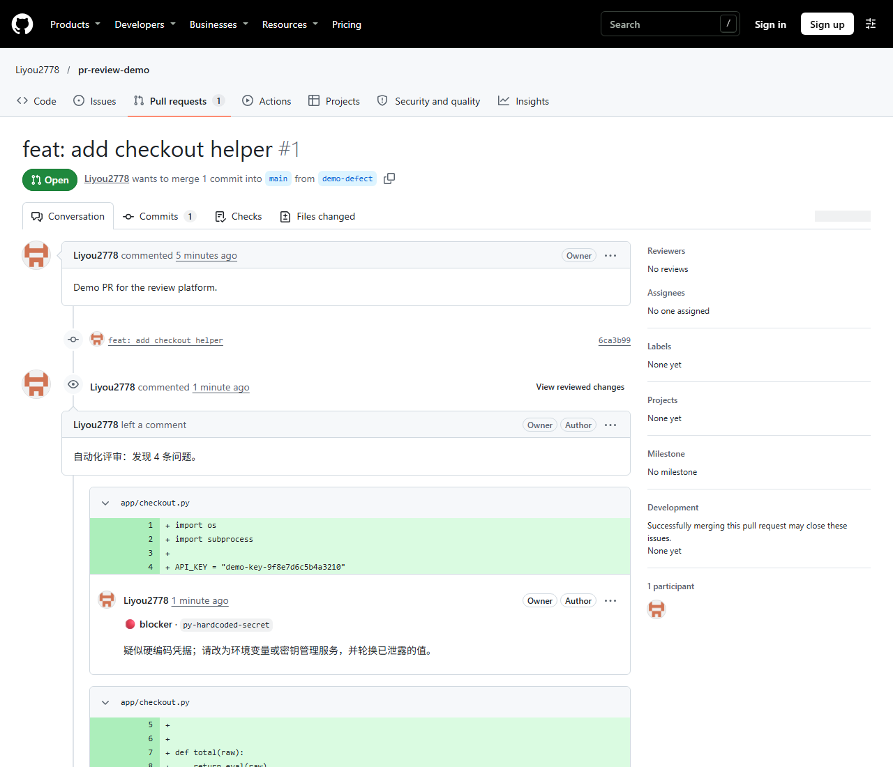

# PR Review Platform

[](https://github.com/Liyou2778/pr-review-platform/actions/workflows/ci.yml)

> 把单机 AI 评审 CLI，做成**组织级服务**：Webhook → 队列 → 评审 → 行级评论 → 指标 → 反馈闭环。
> 目标不是「再写一个 AI 评审」，而是解决它进不了 CI 的三件事：**不可度量、不可治理、不敢全量开**。

---

## 它解决什么问题

| 现状痛点 | 平台的做法 |
|---|---|
| AI 评审「看起来能评，实际不敢用」：漏评、行号飘、质量随 prompt 波动 | 规则与流水线是确定性代码，模型只做判断；行号由 diff 解析器保证 |
| PR 多了跑不动、成本不可控 | 队列 + 并发 worker + 按仓库配额 + 缓存复用 + 超时熔断 |
| GitHub 会重投 webhook，同一 PR 被评两次 | `(provider, delivery_id)` 唯一约束 + `(repo, pr, head_sha)` 唯一 run |
| 每次 push 都重复刷同样的评论 | finding `dedup_key` 跨 run 去重，只发新增 |
| 不知道改完有没有变好 | P/R/F1 + token + P95 指标，回归 diff 可做 CI 门禁 |
| 误报只能忍着 | 反馈落库 → 聚类 → 规则候选（P2） |

---

## 快速开始（本机，无需 Docker）

本机没有 Docker，因此使用**用户态便携版** Postgres 17.6 + Redis 5 + 真实模型，不需要管理员权限。

```powershell
# 1) 安装依赖（uv 自带 Python 3.12）
.\tasks.ps1 setup

# 2) 起 Postgres + Redis（便携版，127.0.0.1）
.\tasks.ps1 services

# 3) 跑契约测试
.\tasks.ps1 test          # SQLite 快车道
.\tasks.ps1 test-pg       # 同一套测试跑在 Postgres 上

# 4) 起 API（终端 A）
.\tasks.ps1 api

# 5) 起 worker（终端 B）
.\tasks.ps1 worker

# 6) 造一次评审（终端 C）
.\tasks.ps1 replay
# 然后：curl http://127.0.0.1:8210/api/runs/1
```

环境细节、版本、踩坑记录见 [docs/environment.md](docs/environment.md)。

**OCR 真实模型验证**（需要 `.env` 里的 `OCR_COMMAND` 与 provider 配置）：

```powershell
.\tasks.ps1 ocr     # 用 DeepSeek 真跑一次 review，打印归一化后的 findings
```

**Docker 路径**（已写好 compose，装好 Docker Desktop 后可用）：

```bash
cp .env.example .env        # 填 GITHUB_WEBHOOK_SECRET
docker compose up --build
curl http://127.0.0.1:8210/healthz
```

---

## 架构

```
GitHub ──webhook(HMAC)──► FastAPI ──► 唯一约束去重 ──► runs(status=queued)
                              │                            │
                              │                            ▼
                              │                     Queue (redis | db | memory)
                              │                            │
                              └──── reads ◄────── Worker ◄──┘
                                                    │
                                    ┌───────────────┼────────────────┐
                                    ▼               ▼                ▼
                              RuleReviewer    OcrReviewer      normalize/dedupe
                              (0 token)       (上游 CLI, P1)   (行号/严重度/上限)
                                                    │
                                                    ▼
                                    findings + cost + latency ──► Postgres/SQLite
                                                    │
                                                    ▼
                                    GitHub Review (dry-run 可关)
```

关键点：

- **API 与 worker 是两个进程**，只通过 DB + 队列通信；`QUEUE_BACKEND=db` 时无需 Redis（runs 表本身就是队列）。
- **claim 是原子的**：`UPDATE runs SET status='running' WHERE id=? AND status='queued'`，重复消息天然幂等。
- **评审引擎可替换**：`rules`（离线确定性）/ `ocr`（上游 CLI），下游（去重、评论、指标）完全不变。
- **评论失败不丢结果**：finding 先落库，评论是后置动作；评论失败只标记 `comment_status`，run 仍 completed。

---

## API

| Method | Path | 说明 |
|---|---|---|
| POST | `/webhooks/github` | HMAC 验签 → 幂等 → 建 run → 入队，返回 202/200 |
| POST | `/api/replay` | 用给定 diff 直接跑一次（Demo / Bench / CI 回放） |
| GET | `/api/runs?limit=&status=` | run 列表 |
| GET | `/api/runs/{id}` | run 详情（含 findings） |
| GET | `/api/runs/{id}/findings` | findings 列表 |
| POST | `/api/runs/{id}/retry` | 失败重试（重新入队、重新评审） |
| POST | `/api/runs/{id}/post` | 只补发未投递的评论（不重新评审、不重复计费） |
| POST | `/api/findings/{id}/feedback` | `false_positive｜fixed｜ignored｜agreed` |
| GET | `/api/feedback/clusters` | 按规则聚类的误报（规则候选来源） |
| POST | `/api/rules/candidates` | 提交规则候选（同规则只保留一个 draft） |
| GET | `/api/rules/candidates?status=` | 候选列表 |
| POST | `/api/rules/candidates/{id}/decision` | `approved｜rejected`（人工门禁） |
| PUT | `/api/repos/{owner}/{repo}/token` | 写入 repo 级 token（加密落库，只回显掩码） |
| PUT | `/api/repos/{owner}/{repo}/policy` | 仓库策略：`min_severity` / 每小时预算 / 开关 |
| GET | `/metrics` | Prometheus 指标 |
| GET | `/api/stats` | run 状态分布、token/成本、P50/P95、反馈分布 |
| GET | `/api/dashboard` | 看板数据（JSON） |
| GET | `/dashboard` | 看板页面（服务端渲染，无前端构建） |
| GET | `/healthz` | 存储/队列/引擎/是否 dry-run |

---

## 数据模型

| 表 | 作用 | 关键约束 |
|---|---|---|
| `repos` | 仓库与加密后的 token | `full_name` 唯一 |
| `deliveries` | webhook 收件箱 | `(provider, delivery_id)` 唯一 → 幂等 |
| `runs` | 一次评审 | `(repo_id, pr_number, head_sha)` 唯一 → 重投不重跑 |
| `findings` | 行级问题 | `(run_id, dedup_key)` 唯一 |
| `feedbacks` | 误报/采纳 | 外键到 finding |
| `costs` | 成本归集 | 一次 run 一条 |

---

## 真实链路验证

不是 mock：平台真的在一个 GitHub PR 上发了评审。

- 演示 PR：<https://github.com/Liyou2778/pr-review-demo/pull/1>
- 结果：**1 条 review + 4 条行内评论**（blocker / high / high / medium），带规则 key 与严重度标签
- 证据截图：[docs/github-pr.png](docs/github-pr.png)



这条链路验证了四件容易出错的事：webhook/replay 取到的 **head_sha 是真实 commit id**（否则 GitHub 返回
`422 invalid $commitOID`）、评论按 **行号** 挂在正确位置、同一 finding **不重复发**、
投递失败后可以 `POST /api/runs/{id}/post` **补发**（不重新评审、不重复计费）。

## 评测与看板

```powershell
# 离线 bench（20 个标注用例：Python / TypeScript / Java，零成本）
.\tasks.ps1 bench

# 真实模型的录制回归（不需要 key）
.\tasks.ps1 bench-ocr

# 质量门禁：F1 下降超过阈值直接 fail（CI 里用）
.\tasks.ps1 gate

# 重新录制一次真实模型输出（会花钱，约 $0.03）
.\tasks.ps1 record

# 真实模型端到端（克隆 workspace → OCR → 落库 → 去重）
.\tasks.ps1 e2e

# 看板（浏览器打开）
http://127.0.0.1:8210/dashboard
```

实测（2026-11-18）：

| 引擎 | 用例 | P | R | F1 | 成本 |
|---|---:|---:|---:|---:|---:|
| 确定性规则层 | 20 | 1.000 | 1.000 | 1.000 | $0 |
| 真实 OCR + DeepSeek（录制回放） | 20 | 0.769 | 0.800 | 0.784 | $0.0265 / 次 |

> 规则层满分是「规则与用例同源」的结果，不代表泛化；模型层的 0.784 更有参考价值，
> 且多缺陷用例因模型合并成一条跨行评论而计为 FN（口径保守）。

看板包含：run 状态分布、P50/P95、按仓库的 token/成本、findings 严重度分布、
误报率、按规则聚类的误报（规则候选的来源）。

## 安全模型（部署前必读）

| 面 | 机制 | 配置 |
|---|---|---|
| webhook 真实性 | HMAC-SHA256 验签，失败即 401；缺失签名同样拒绝 | `GITHUB_WEBHOOK_SECRET` |
| 变更接口鉴权 | 所有 `POST/PUT/PATCH/DELETE /api/*` 需要 `X-API-Token`；非 dev/test 未配置 token 直接 **503**（宁可不可用，不可裸奔） | `API_TOKEN` |
| 启动校验 | 非 dev/test 下：secret 是默认值、缺 token、缺 `FERNET_KEY` → **进程启动失败** | `APP_ENV` |
| clone 白名单 | 只允许 https + `ALLOWED_CLONE_HOSTS`；`file://` 一律拒绝；本地路径仅 dev/test（防 SSRF/本地文件读取） | `ALLOWED_CLONE_HOSTS` |
| 凭据隔离 | 优先 repo 级 token（`PUT /api/repos/{owner}/{repo}/token`，Fernet 加密落库，只回显掩码），进程级 token 仅兜底 | `FERNET_KEY` |
| 请求体上限 | 超过 `MAX_REQUEST_BYTES` 直接 413，避免大 payload 打爆 worker | `MAX_REQUEST_BYTES` |

生产环境的最小配置：

```bash
APP_ENV=prod
GITHUB_WEBHOOK_SECRET=<32 字节随机>
API_TOKEN=<32 字节随机>
FERNET_KEY=<Fernet key>
GITHUB_DRY_RUN=false
```

> 注意：`API_TOKEN` 是服务级凭据，不是用户体系。要做多用户/多租户，下一步是引入 OIDC 或反向代理注入身份，
> 当前设计只解决「谁可以调用变更接口」。

## 可观测性与运维

| 能力 | 用法 | 说明 |
|---|---|---|
| Prometheus 指标 | `GET /metrics` | runs/findings/按引擎 p95/成本/误报率，text exposition |
| 请求追踪 | 响应头 `X-Request-Id` | 客户端可传入自定义 id，日志按 id 关联 |
| 结构化日志 | `LOG_JSON=true` | 一行一个 JSON，直接接日志系统 |
| 保留策略 | `python scripts/retention.py --days 30` | 默认 **dry-run**，加 `--apply` 才真删 |
| 并发 worker | `WORKER_CONCURRENCY=4` | 原子 claim 保证不重复；单 loop 异常不拖垮进程 |
| 投递重试 | `POST_RETRIES=3` | 指数退避；4xx 不重试（避免白烧时间） |
| 仓库策略 | `PUT /api/repos/{owner}/{repo}/policy` | `min_severity` 只发高危、`max_runs_per_hour` 预算、`enabled` 开关 |
| 已修复状态 | `finding.resolved` / `resolved_at` | 后续 run 不再报同一条时自动标记 |

## 状态

| 阶段 | 内容 | 状态 |
|---|---|---|
| P0 | webhook 验签/幂等、队列、worker、规则引擎、行号映射、去重、反馈、指标 | ✅ 完成 |
| P1 | OCR CLI 接入（真实 DeepSeek）、git workspace 克隆、结果归一化、端到端落库 | ✅ 完成（2 findings / 19s / $0.019） |
| P1.5 | GitHub 评论回写（单 review + N 行级评论、posted 标记、失败可补发） | ✅ 真实 PR 跑通（4 条行内评论） |
| P2 | 20 用例 bench（3 语言）、两级 CI 门禁、录制回放回归、误报聚类、成本看板 | ✅ 完成 |
| P2.5 | 规则候选状态机（draft→approved/rejected）+ 人工门禁 | ✅ 完成 |
| P3 | 仓库策略（阈值/预算/开关）、resolved 状态、投递重试、Prometheus、JSON 日志、保留脚本、worker 并发 | ✅ 完成 |

> **诚实声明**：默认引擎是自带的确定性规则层（正则 + 路径/语言约束），不是大模型；
> 它的价值是给平台一条可离线、可复现的基线与门禁。真实模型能力看 bench 的
> 「录制回放」那一行（P=0.769 / R=0.800 / F1=0.784）。

---

## 设计决策（面试会问）

1. **为什么不用 Celery？** 一个 run 就是一个 id，Redis list 足够；Celery 的 broker 语义、结果后端、序列化开销都是额外故障面。规模上来再换。
2. **为什么行号要自己解析？** 模型给的是「文件 + 相对位置」，GitHub 要的是新文件绝对行号；解析错了评论会飘到第 1 行。
3. **为什么评论失败不算 run 失败？** 评审结果比通知重要；通知可以重放，评审结果丢了要重花钱。
4. **为什么 dry-run 是默认？** 写操作的默认值决定事故半径。默认不写，打开要显式配置。
5. **为什么规则要带 fixtures？** 否则改规则就是「感觉变好了」，无法回归。

更完整的取舍记录见 [docs/adr/](docs/adr/)：两层引擎、幂等与去重的拆分、队列与数据库的关系。

## 架构决策记录（ADR）

代码会变，决策的约束不该丢。每个 ADR 记录「当时有哪些选项、为什么选这个、代价是什么」，
而不是事后补一段解释。完整列表见 [docs/adr/](docs/adr/)。

| 编号 | 决策 | 核心权衡 | 代价 |
|---|---|---|---|
| [0001](docs/adr/0001-two-tier-engines.md) | 规则引擎与模型引擎并存 | 规则层零成本、可复现，做基线与 CI 门禁；模型层做语义 | 两套 severity 词表要映射，规则要带 fixtures 回归 |
| [0002](docs/adr/0002-idempotency-vs-dedupe.md) | 幂等与去重拆成三层 | webhook 幂等、run 唯一、评论去重各自有独立事实来源 | 多一列 `posted` 状态和一个补发接口 |
| [0003](docs/adr/0003-queue-is-an-optimization.md) | 队列是优化，DB 是事实来源 | broker 故障只影响延迟，不丢任务；本地无需 Redis | 多一次 DB 轮询；多 worker 要注意 claim 竞争 |

**什么值得写 ADR**：有真实取舍（两个方案都能 work）、写清后果（包括代价）、不依赖当时的口头讨论。
反例：「我们用 FastAPI」不是决策，「webframework 选 FastAPI 因为 async + Pydantic 校验 + OpenAPI 自动生成，
代价是同步代码要写成 async」才是。

---

## 目录

```
apps/api/          FastAPI：webhook、runs、findings、feedback、stats
apps/worker/       worker：pop → claim → review → persist
core/              配置、DB、模型、队列、安全、规则、diff 解析、服务层
core/adapters/     github.py（webhook/diff/review）、reviewer.py（rules|ocr）
rules/             规则即代码（YAML + 正负 fixtures）
tests/             契约测试
docs/              spec / architecture / ADR / runbook
```
